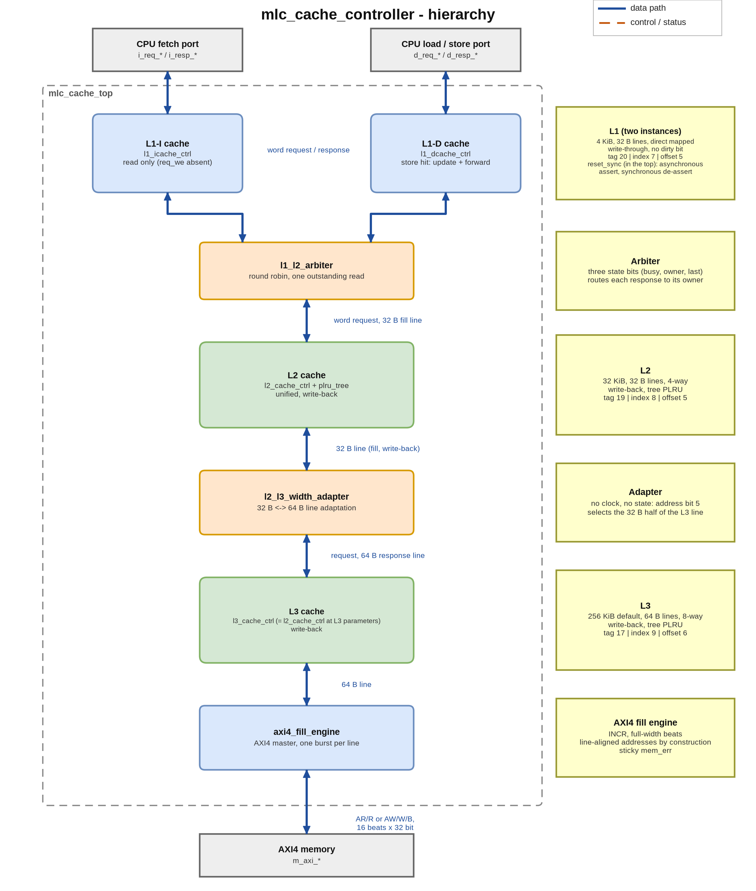
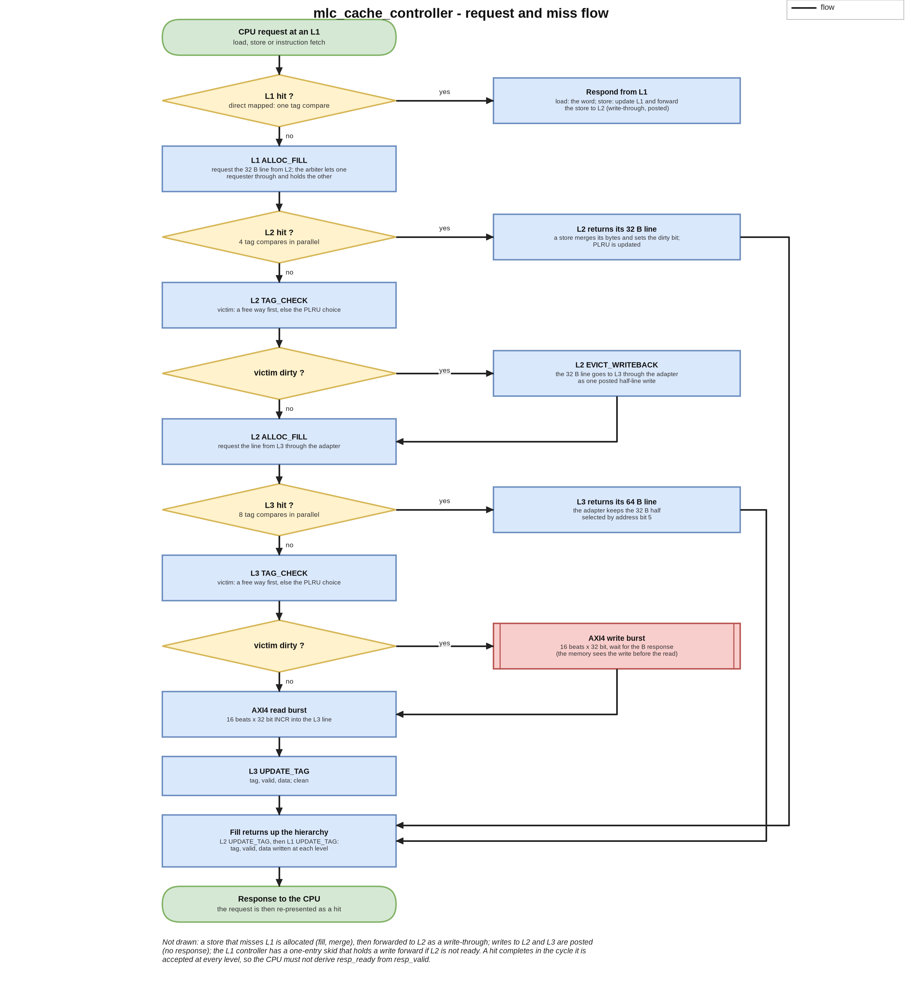
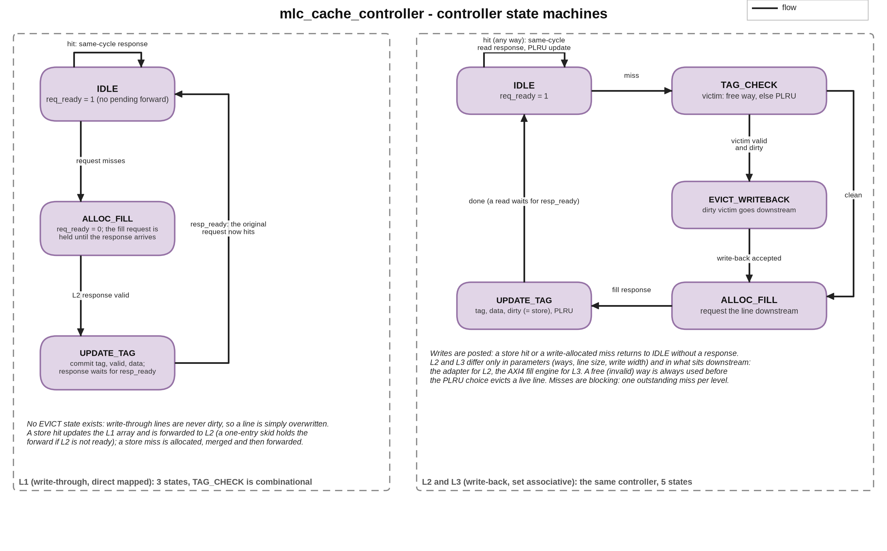

## A. Project overview

### A.1 Purpose

`mlc_cache_controller` is a parameterised cache hierarchy controller in SystemVerilog, with three levels (L1 / L2 / L3) and a single
requester. Split L1 instruction and data caches (direct mapped, write-through) share one unified L2 (set associative, write-back,
tree-PLRU) through an arbiter. A 2:1 line-size adapter connects L2 to an L3 (set associative, write-back, tree-PLRU, with twice the line
size), and an AXI4 fill engine turns each L3 miss or dirty eviction into one burst on a memory-side AXI4 master. It's a memory-subsystem
design, and what I cared about was making a different trade-off at each level, getting the boundary logic between levels right, and
having evidence that each piece works.

### A.2 Problem statement and motivation

A cache hierarchy is a handful of simple ideas (tag compare, victim choice, write policy) joined by interface contracts that are easy
to get subtly wrong. A hit and its response have to be one event, a fill request has to stay valid until it's answered, a posted write
must never get a response, and two requesters have to share one lower port without losing a response. I built the project around
writing those contracts down explicitly, testing the boundaries where they meet, and measuring what the resulting hardware costs.

### A.3 Scope and requirements (as implemented)

| ID | Requirement | Status |
|---|---|---|
| R1 | L1-I and L1-D: 4 KiB, 32 B lines, direct mapped, write-through, no dirty bit, same-cycle hit response | implemented, simulated (unit tests and the system test) |
| R2 | L2: 32 KiB, 32 B lines, 4-way, write-back, tree-PLRU, write-allocate, unified | implemented, simulated |
| R3 | L3: 256 KiB (default), 64 B lines, 8-way, write-back, tree-PLRU; one controller shared with L2 at different parameters | implemented, simulated (system test uses the default size) |
| R4 | `l2_l3_width_adapter`: 32 B to 64 B line adaptation, half select by address bit 5, write-back as a posted half-line write | implemented, simulated |
| R5 | `l1_l2_arbiter`: one L2 port for two L1s, round-robin, response routed to the owner | implemented, simulated |
| R6 | `axi4_fill_engine`: one INCR burst per line, 16 beats of 32 bits at the defaults, one transaction in flight, sticky `mem_err` | implemented, simulated against an AXI4 memory model that checks the burst shape |
| R7 | Parameter guards at elaboration (power-of-two sizes, 2:1 line ratio, burst length) | implemented, simulated (`make elab`: accepted and rejected sets under Icarus and Yosys) |
| R8 | Synthesis to Sky130HD and static timing of every unit | done for every unit except the default 256 KiB L3 (out of memory; measured to 32 KiB) and the top (wiring only) |
| R9 | UVM environment, formal properties, place and route, whole-hierarchy timing | **NOT DONE / NOT MEASURED** (UVM needs an external simulator; the other items are not attempted) |

Left out by design: a coherence protocol and an inclusion policy (there's one requester, so neither is needed; the hierarchy is
non-inclusive non-exclusive), virtual memory, non-blocking misses (blocking misses keep the verification matrix manageable, and I list
them as a limitation), write buffers and prefetch.

### A.4 Target application and concepts

A memory subsystem between one CPU (an instruction fetch port plus a load/store port) and an AXI4 memory. Building it covers address
partitioning derived from parameters, tag, valid and dirty state, write-through against write-back, write allocation, tree pseudo-LRU,
eviction and fill sequencing, line-size adaptation, posted writes, arbitration, burst generation, and interface contracts that avoid
deadlock.

### A.5 Key features and measurable objectives

- A different trade-off at each level: L1 is direct mapped and write-through (no way mux, no eviction state), L2 and L3 are set
  associative and write-back (fewer conflict misses and less downstream traffic).
- At every level a hit completes in the cycle it's accepted.
- L2 and L3 share one controller, and the adapter is the only place where the two line sizes meet.
- Measured: unit synthesis area and cell counts, the minimum clock period of each unit with its limiting class of path (section H),
  and a system-level data-integrity test over the whole hierarchy with an injected-bug campaign (section G).

---

## B. Architecture and block diagram

### B.1 Overview

`mlc_cache_top` is purely structural. The two L1 controllers present the same request / response interface to the CPU and the same
downstream interface to the arbiter. L2 has a single upstream port and doesn't know which L1 a request came from. The adapter has no
clock and no state. L3 is the L2 controller module instantiated with L3 parameters and with its write width set to one L2 line, so an
L2 write-back arrives as one posted half-line write. The fill engine is the only block that knows about AXI4.

### B.2 Blocks and responsibilities

| Block | File | Responsibility |
|---|---|---|
| `l1_cache_ctrl` (L1-I, L1-D wrappers) | `rtl/l1/` | direct-mapped tag / data array, hit path, 3-state miss FSM, one-entry write-forward skid, write-through forward |
| `l1_l2_arbiter` | `rtl/arbiter/` | picks one L1 request (round-robin on a tie), holds the other, remembers the owner of an outstanding read and routes its response; three state bits |
| `l2_cache_ctrl` | `rtl/l2/` | set-associative write-back controller with 5-state miss FSM, victim register, merge of write data, dirty tracking; reused as L3 |
| `plru_tree` | `rtl/replace/` | tree pseudo-LRU for any power-of-two way count |
| `l2_l3_width_adapter` | `rtl/adapter/` | combinational: request pass-through, half select of the 64 B response by address bit 5, L2 write-back to L3 write data with all strobes set |
| `l3_cache_ctrl` | `rtl/l3/` | `l2_cache_ctrl` at the L3 parameters |
| `axi4_fill_engine` | `rtl/mem_if/` | 6-state AXI4 master (IDLE, AR, R, RESP, WR, B) generating one fixed-length INCR burst per line request |
| `reset_sync` | `rtl/common/` | asynchronous assert, synchronous de-assert, applied once in the top |
| `mlc_pkg` | `rtl/common/` | the parameters; each level derives its tag / index / offset widths from them with `$clog2` |

### B.3 Interfaces

On the CPU side (one instance per L1) the signals are `req_valid/ready`, `req_addr`, `req_we`, `req_wdata`, `req_wstrb`,
`resp_valid/ready` and `resp_rdata`; the fetch port has no `req_we`. The links between levels have the same shape plus a full-line
response (`resp_line`) and a full-line write-back payload (`req_line`). The memory side is a full AXI4 master (`m_axi_*`, no IDs, constant
sideband values as parameters) plus a sticky `mem_err`.

Three contracts bind everything together:

1. The CPU must not derive `resp_ready` from `resp_valid`, because an L1 hit only raises `resp_valid` in a cycle in which it's also
   accepting the request.
2. A fill request's `req_valid` stays high for the whole fill, so a level further down has to hold `req_ready` low until it has answered.
3. Writes on the links between levels are posted, so no level ever answers a write.

### B.4 Data and control paths

A read hit does the tag compare and the data read in the cycle of the request. On a read miss, L1 `ALLOC_FILL` asks L2 for a 32 B line
through the arbiter. L2 either hits, or evicts a victim (writing it back through the adapter if it's dirty), fills from L3 (the adapter
selects the requested 32 B half of an L3 line) and returns the line. L3 in turn either hits, or evicts and fills through one AXI4
burst. On a store, an L1 hit updates L1 and forwards the store to L2 (write-through, posted), and L2 merges it into its line and marks
it dirty. A dirty line only reaches L3 when it's evicted, and only reaches memory when L3 evicts it.

---

## C. Draw.io architecture diagram



The diagram files are in `docs/portfolio/diagrams/`: `mlc_architecture.drawio` (editable), `.png` and `.svg`, and the same three for
`mlc_flowchart` and `mlc_fsm`. `make_diagrams.py` writes all of them from one specification, so the `.drawio` is generated rather than
exported from draw.io.

---

## D. Design flowchart





---

## E. Detailed design explanation

### E.1 Address partitioning

Each level splits the 32-bit address into tag, index and offset with widths derived from its own parameters, and an elaboration-time
check requires `sets x ways x line = capacity`. L1 uses tag 20, index 7 and offset 5 (128 lines), L2 tag 19, index 8 and offset 5 (256
sets x 4 ways), and L3 tag 17, index 9 and offset 6 (512 sets x 8 ways). L3's index sits at different bit positions from L2's for the same
address bits. That's correct: each level indexes by its own line size, and the only thing the adapter needs the two levels to agree on
is which L2 line lies in which half of an L3 line.

### E.2 L1: write-through, direct mapped

The hit path is one tag compare and one data read, with no way multiplexer. There's no dirty bit and no eviction state: a write-through
line is never dirty, so a replaced line is simply overwritten in `UPDATE_TAG`. A store hit updates the array and forwards the store
downstream in the same cycle. If L2 can't take it, a one-entry skid register holds the forward and `req_ready` stays low until it
drains. A store miss is allocated (the line is fetched and the store merged) and then forwarded. `req_ready` stays low for the whole miss,
and the original request is presented again as a hit after `UPDATE_TAG`.

### E.3 L2 and L3: write-back, set associative

On a miss the controller latches the line-aligned address and picks a victim, a free way if there is one and otherwise the PLRU
tree's choice. If the victim is valid and dirty it writes it back (`EVICT_WRITEBACK`), then fetches the new line (`ALLOC_FILL`) and
commits the tag, data, dirty bit (set when the request was a store) and PLRU state (`UPDATE_TAG`). Writes from above are posted: a store
hit or a write-allocated miss goes back to `IDLE` without a response. A free way is always used before a live line is evicted, because
hits can steer the tree towards a live way while an invalid way is still free. Arrays that need no reset (tag, dirty, data) are kept in
a reset-free block so synthesis infers memories, and only the valid array and the FSM are reset.

### E.4 Tree-PLRU

Each set has `WAYS - 1` bits forming a binary tree. An access sets the bits on the path away from the accessed way, and the victim is
found by following the bits. The module is parameterised on the way count (3 state bits per set for L2's 4 ways, 7 for L3's 8 ways) and
has its own tests over several way counts.

### E.5 Line-size adapter and write-back path

An L2 request is answered with exactly the 32 B half it asked for, selected by address bit 5, and the other half is never pushed into L2
speculatively (the hierarchy is non-inclusive). L3 is elaborated with a write width equal to one L2 line, so an L2 write-back is a merge
into a two-slot line, with the slot taken from address bit 5 and all strobes set. It sets the L3 dirty bit without needing the other
half to be present or dirty.

### E.6 AXI4 fill engine

There are two triggers, and each produces one burst of `L3_LINE_B / AXI_DATA_W` beats (16 at the defaults): an L3 miss (AR, then R) and
an L3 dirty eviction (AW and W together, then B). Addresses are line-aligned by construction, because the shared controller latches the
miss address with its offset bits cleared, so the engine has no alignment logic. A write completes (B received) before the fill read
that follows it, so memory sees an eviction before the line that replaced it. `mem_err` is sticky. It's set by an error response, or by
an `RLAST` that disagrees with the beat count. The engine counts beats and has no timeout, so `mem_err` is a diagnostic, not a way to
recover.

### E.7 Reset, ordering and errors

Reset is asserted asynchronously and released synchronously in the top. The valid arrays and the FSMs clear; the data and tag arrays
don't. Misses block and there's one requester at each boundary, so no response can overtake another and at most one read is outstanding
at the arbiter. There are no software-visible registers and no error response towards the CPU; memory errors are only reported on
`mem_err`.

### E.8 Design decisions and trade-offs

| Decision | Alternative | Reason / cost |
|---|---|---|
| L1 direct mapped, write-through | set associative, write-back | no way mux, no eviction state, shorter critical path and FSM; costs write traffic to L2 and conflict misses |
| L2 / L3 write-back, PLRU | LRU, write-through | less downstream traffic and conflict misses, cheaper than true LRU; costs dirty state and an eviction state |
| L3 line twice L2's | same line size | amortises burst overhead nearest to memory; costs the adapter and the half-line write path |
| One controller for L2 and L3 | two modules | one implementation to verify; the two bugs recorded as D-021 lived on boundaries, not inside a controller |
| No coherence, NINE | inclusive hierarchy, MESI | exists to bound multi-agent snoop traffic, a problem a single requester does not have |
| Blocking misses | MSHRs, hit-under-miss | tractable verification matrix; limits miss-level parallelism |
| Posted writes on inter-level links | write responses | a response would deadlock against L1's skid register and could hand L1 a stale line |
| Register-array storage, no macros | SRAM macros | the flow has no macro generator; every stored bit is a flip-flop plus multiplexing (section H) |

---

## F. Interface and timing details

The CPU side uses valid / ready in both directions. A hit completes in the cycle it's accepted: `resp_valid` goes up together with
`req_ready`, and `req_ready` for a hit requires `resp_ready`, so a CPU that derives `resp_ready` from `resp_valid` deadlocks (the first
contract in B.3). A miss holds `req_ready` low until `UPDATE_TAG`, and its response is held there until `resp_ready`. The exact miss
latencies depend on the configuration, so they aren't fixed numbers. Between levels, the fill request is held for the whole fill, writes
are posted (they complete when `req_ready` accepts them), and everything a level sends downstream is line-aligned. The memory side is
AXI4 with INCR bursts of full-width beats, one outstanding transaction and no IDs. The memory model used in simulation checks burst
length, size, type, alignment, `WSTRB`, the position of `WLAST` and payload stability.

Operating assumptions: one clock with no clock-domain crossing, physical addresses, word-aligned CPU accesses (the low two address bits
are assumed to be zero), and no writes to the fetch port.

---

## G. Verification and testing

### G.1 Verification environment

The testbenches are plain, class-free SystemVerilog on Icarus Verilog 12, directed, with one testbench per unit plus three boundary
tests. `make check` also runs the parameter-guard cases, a structural check of the top (every port connected by name, one driver per
signal, only wires and instances), the Yosys elaboration check, an RTL coding-rule check and the self-tests of the synthesis and timing
flows. The testbenches use stubs and an AXI4 memory model that checks the protocol.

### G.2 Unit and boundary tests

In the original repository, `make sim` (with logs checked in under `sim/logs/`) runs 13 testbenches with 594 checks in total:
`reset_sync` (4), L1-I (4), L1-D (91), PLRU (23), PLRU over way counts (98), L2 (120), adapter (41), AXI4 fill engine (50), L3 (47),
arbiter (45), and three boundary-contract tests: L1 to L2 (11), both L1s through the arbiter to L2 (41), and L2 to adapter to L3 to the
fill engine (19). The L1-I test only has 4 checks, but the system test below fetches through it 4,000 times. The portfolio copy adds the
system test (5 checks) and, from the assertion work in G.5, 5 checks to the fill engine test (now 55) and 3 to the arbiter test (now 48).
That makes 14 testbenches and 607 checks.

### G.3 System-level test of the integrated hierarchy (added in this portfolio copy)

The original project says the integrated top "elaborates cleanly but has not been simulated" and leaves its behaviour to the UVM tier,
which needs a simulator that isn't installed. `sim/tb_mlc_top.sv` closes that gap for data integrity without UVM. It instantiates
`mlc_cache_top` at its default sizes with the AXI4 memory model and drives the instruction and data ports at the same time: first
directed sweeps of conflicting addresses that overflow each level, then a constrained-random load/store mix with partial byte strobes
and idle gaps, then a read-back sweep. It compares **every** load and fetch with a flat reference memory that has no cache in it. The
data region (384 KiB) is larger than the L3 (256 KiB), so lines get evicted at every level and dirty lines are written all the way back.

```text
PASS: 11051 D loads, all equal to the flat reference memory (0 mismatches)
PASS: 4000 instruction fetches (L1-I), all equal to the reference (0 mismatches)
INFO: 6105 D stores issued
INFO: AXI traffic: 7044 read bursts (112704 beats), 1139 write bursts (18224 beats)
PASS: the AXI4 memory model saw no protocol error from the master
PASS: mem_err stayed low
PASS: dirty lines were evicted all the way to memory (1139 write bursts)
tb_mlc_top: ALL CHECKS PASSED
```

What this test **doesn't** do: run on its own under Icarus it has no functional coverage and no assertions (the bound checkers of G.5
run on it under Verilator). It doesn't check performance (hit rates, latency, replacement quality). The fetch port reads a region that
the data port never writes, because the project has no coherence between the two L1s. And it runs one seed.

### G.4 Does the system test notice bugs? Injected-bug campaign

Each of 23 one-line edits of the RTL (L1 store paths, L2 / L3 dirty and write-back logic, the strobe merge, the adapter, the arbiter,
the AXI4 engine) is compiled into a copy and run through the full system test (`scripts/mutate_top.py`):

```text
mutants run: 23, killed 20, survived 3, invalid 0 (each through the full system test sim/tb_mlc_top.sv)
a survivor is expected where the edit changes only replacement quality or fairness: the test checks data integrity, not performance.
PROBLEMS: none (every outcome matched its expectation)

M01  KILLED    L1: a store hit does not update the L1 data array                      [expected: killed] FAIL: load 0x0000020c returned 0xc0de0083, reference 0xc0350083
M02  KILLED    L1: the write-through forward of a store hit ignores the byte strobes  [expected: killed] FAIL: load 0x00000378 returned 0x4aa01822, reference 0xc0de0022
M03  KILLED    L1: a store miss is not forwarded to L2                                [expected: killed] FAIL: load 0x00000040 returned 0xc0de0010, reference 0xa5a50000
M04  KILLED    L1: a store miss does not merge the store into the filled line         [expected: killed] FAIL: load 0x00000670 returned 0xc0de019c, reference 0x7467c86f
M05  KILLED    L1: a hit returns the neighbouring word                                [expected: killed] FAIL: fetch 0x00071824 returned 0xc0dfc608, expected 0xc0dfc609
M06  KILLED    L2/L3: a store hit does not set the dirty bit                          [expected: killed] FAIL: load 0x00000040 returned 0xc0de0010, reference 0xa5a50000
M07  KILLED    L2/L3: a write-allocated line is not marked dirty                      [expected: killed] FAIL: load 0x00028040 returned 0xa5a52005, reference 0xa5a52105
M08  KILLED    L2/L3: a write-back goes to the address of the incoming line           [expected: killed] FAIL: load 0x00000040 returned 0xa5a50006, reference 0xa5a50000
M09  KILLED    L2/L3: a write-back sends way 0's data instead of the victim's         [expected: killed] FAIL: load 0x00001040 returned 0xa5a50003, reference 0xa5a50001
M10  KILLED    L2/L3: the byte-strobe merge ignores the strobes                       [expected: killed] FAIL: load 0x00000378 returned 0x4aa01822, reference 0xc0de0022
M11  KILLED    L2/L3: a write-allocate miss drops the store                           [expected: killed] FAIL: load 0x00028040 returned 0xa5a52005, reference 0xa5a52105
M12  KILLED    L2/L3: a store hit is not written                                      [expected: killed] FAIL: load 0x00000040 returned 0xc0de0010, reference 0xa5a50000
M13  SURVIVED  L2/L3: the eviction does not wait for the write-back to be accepted    [expected: survives: equivalent in this integration (the downstream is always ready when L2 evicts: one requester, blocking misses); tb_l2 with a stalling stub kills it] 
M14  KILLED    L2/L3: a filled line is never marked valid                             [expected: killed] FAIL: load 0x00000040 returned 0xc0de0010, reference 0xa5a50000
M15  SURVIVED  L2/L3: the PLRU tree is ignored, a full set always evicts way 0        [expected: survives: replacement quality is not data-visible] 
M16  KILLED    adapter: the half-line select is inverted                              [expected: killed] FAIL: load 0x00000000 returned 0xc0de0008, reference 0xc0de0000
M17  KILLED    adapter: write-backs to L3 carry no strobes                            [expected: killed] FAIL: load 0x00000040 returned 0xc0de0010, reference 0xa5a50000
M18  KILLED    arbiter: a miss response goes to the other requester                   [expected: killed] FAIL: fetch 0x00071820 returned 0xc0de0000, expected 0xc0dfc608
M19  SURVIVED  arbiter: round-robin removed, L1-I wins every tie                      [expected: survives: fairness is not data-visible] 
M20  KILLED    AXI engine: write beats carry no strobes                               [expected: killed] AXI PROTO: WSTRB 0x0, expected all ones (t=0)
M21  KILLED    AXI engine: write bursts go to the neighbouring line                   [expected: killed] FAIL: load 0x00000040 returned 0xc0de0010, reference 0xa5a52000
M22  KILLED    AXI engine: read bursts are one beat short                             [expected: killed] AXI PROTO: ARLEN 14, expected 15 (t=0)
M23  KILLED    AXI engine: WLAST on the second-to-last beat                           [expected: killed] AXI PROTO: WLAST 1 on beat 14 of 16 (t=0)
```

How to read the survivors: M15 (the PLRU tree ignored) and M19 (round-robin removed) change replacement quality and fairness, which a
data-integrity test can't see by design. M13 (an eviction that doesn't wait for its write-back to be accepted) is equivalent *in this
integration*: with one requester and blocking misses, the level below is always ready at that point. The unit test `tb_l2`, whose stub
can stall, does catch it (9 failing checks, run separately). That's the argument for keeping both tiers.

### G.5 Bound assertions, cover points and a second injected-bug campaign

`verif/mlc_checkers.sv` holds assertions (`a_*`), cover points (`c_*`) and a few procedural checks (`sb_*`). `verif/mlc_binds.sv` binds
them into both instances of the L1 controller, the L2 / L3 controller (which the L3 controller instantiates), the L1 to L2 arbiter, the
PLRU tree, the AXI4 fill engine and the L2 to L3 width adapter, so the RTL is untouched and every testbench that instantiates a module
runs its checker.

The rules come from `docs/04_interfaces.md` and the microarchitecture tables. A hit completes in its accept cycle and only then (PF-01),
and it's only accepted when the CPU can take the response. Misses block (FR-05), and the miss sequence is checked arc by arc. The fill
request is held with a stable address for the whole fill, with the response channel open only then. Writes are posted (D-021).
Write-backs only happen for a valid dirty victim, to its own line and never to the line being fetched. The arbiter's one-at-a-time and
routing rules and its round robin are checked (D-033), and so is the tree-PLRU property that the way just used is never the next victim.
Then there are the AXI4 master rules: a channel holds its payload until it's accepted, the burst shape, the 4 KB window, WLAST, one
transaction at a time, error flagging, and scoreboards for the beats read and written. As in the FIR accelerator, every conditional
assertion gets an automatically generated cover of its antecedent (`scripts/gen_vacuity.py`), so an assertion that passed vacuously gets
reported.

I reused the repository's own Icarus testbenches, with the additions listed below. Twelve of the fourteen run under Verilator 5.052:
`tb_l3` hits an internal fault in that simulator, and `tb_reset_sync` contains no module a checker binds to. (L3 is the same module as L2
with other parameters, and the L2-to-L3 chain test and the system test exercise it.) State is zero-initialised, because with random
power-up state the testbenches themselves report spurious forwards counted before reset (Icarus's X values hide them). The result on the
unmodified RTL (`scripts/sva_run.py`):

```text
mlc_cache_controller: bound checkers under Verilator 5.052 on the repository's own testbenches (12 runs, unmodified RTL)
runs                      : 12 testbenches, all passed and no checker fired: yes
assertions defined        : 106 labelled (103 concurrent, 3 procedural checks)
conditional assertions    : 85, antecedent reached in at least one run: 85
cover bins                : 59, hit: 59, zero: 0 (excluded with a reason: 0)
note                      : gen_vacuity: 85 conditional assertions got an antecedent cover; 12 unconditional (never vacuous): a_resp_ready_def, a_one_hit, a_l2_resp_ready_def, a_plru_event, a_one_ready, a_unselected_wait, a_victim_range, a_wlast_def, a_one_txn, a_ready_def, a_rready_def, a_bready_def
problems                  : none
```

Writing the covers showed one situation that no test produced: a new request presented to the AXI4 fill engine in the cycle right after
the previous response was taken. I added a directed scenario for it to `sim/tb_axi4_fill_engine.sv`. The campaign below turned up two
more (see the end of this section), and both are in the testbenches now.

**Checking the checks.** `scripts/sva_mutants.py` runs the 23 mutants of G.4 again, this time against every testbench that contains the
edited file (unit, boundary and system tests) with the checkers bound, and adds 83 new ones in two groups. The 31 `N` mutants target the
interface contracts and protocol rules that a data-integrity test can't see: a phantom response, a hit accepted without the response
being takeable, a dropped forwarded store, a response channel that's always open, an arbiter that shows L2 a request while a read is
outstanding, a PLRU that updates towards the way just used, an AXI engine that abandons a channel without its ready, and so on. I wrote
the 52 `P` mutants afterwards, one for each assertion that none of the first 54 had made fire, because a campaign that never makes an
assertion fire hasn't shown that the assertion can fail. A run counts as "caught by the tests" only when a testbench check failed (a
`FAIL` / `ERROR` / `FATAL` / `AXI PROTO` line, one of its own `assert`s, a timeout, or an exit without its verdict). A run that the
checkers stopped themselves (the simulator's error limit) counts as caught by an assertion. A run is killed after 300 s with its whole
process group, and no run in this campaign needed that. The result (`results/sva/mutants.txt`, first lines):

```text
mutants: 106, caught 106 (by tests 96, by an assertion only 10), survived 0, invalid 0
caught ONLY by an assertion (the testbenches missed them): N04, N13, N31, P02, P07, P09, P22, P41, P42, P43
survivors (each with its reason): none
assertions defined: 106; fired in at least one mutant run: 105
assertions that fired in no run: none
assertions no RTL edit can violate (reason in verif/sva_unviolable.txt): a_victim_range
mutants whose expected assertion did not fire (another one did): none
PROBLEMS: none
```

What the `P` mutants added to the testbenches:

1. `P28` (the arbiter tells requester 1 "accepted" while a read is outstanding) survived, and no assertion fired. The L2 model in
   `tb_arbiter` is, like the real L2, never ready at that point, so the arbiter's own refusal was never exercised. `tb_arbiter` now has a
   phase with an L2 that claims to be ready the whole time one of its reads is outstanding. The arbiter still mustn't pass the request
   on, and the write offered in the meantime has to reach L2 afterwards.
2. `P42` (RREADY waits for RVALID, which is legal AXI) couldn't be told apart from the engine's own rule, because the memory model
   answers the first beat at once. The model now has a switch (`first_gap_en`, set from the testbench), and `tb_axi4_fill_engine` reads
   a line whose first beat is four cycles late.

One assertion, `a_victim_range`, can't be violated by any edit: the victim index is a `$clog2(WAYS)`-bit value and `WAYS` has to be a
power of two. It's listed with that reason in `verif/sva_unviolable.txt` and reported separately from the 105 that were shown to fire.
Ten mutants are caught only by an assertion (`N04`, `N13`, `N31`, `P02`, `P07`, `P09`, `P22`, `P41`, `P42`, `P43`). Each is a protocol
or timing fault that leaves every testbench passing, for example a request accepted a cycle early, a response channel left open, or a
signal that changes in the cycle a response arrives.

One observation that isn't a defect: the L1 controller latches the CPU's request address as its fill address, word offset included,
while `docs/04_interfaces.md` says every request a level sends downstream is line-aligned. L2 derives index, tag and slot from the full
address and doesn't depend on alignment, and L2 and L3 do send aligned addresses (the assertion `a_l2_fill_request` checks this for
them), so the document is stricter than the design needs for L1.

### G.6 Simulation commands and tool requirements

```bash
make check                 # parameter guards, top check, every testbench (now 14), Yosys lint, flow self-tests
make sva                   # the testbenches under Verilator 5.052 with the bound checkers (53 s from a cold start with 7 jobs)
make sva-mutants           # the second injected-bug campaign, 106 mutants (1126 s with `scripts/sva_mutants.py --jobs 7` on 8 cores; the target uses 4 jobs)
make test-tb_mlc_top       # the system test only
python3 scripts/mutate_top.py --jobs 3    # the injected-bug campaign for the system test
python3 scripts/doc_snippets.py           # regenerate the result tables quoted in this document
```

Tools: Icarus Verilog 12, Yosys 0.33, Python 3 and OpenSTA 2.7.0. `make sva` and `make sva-mutants` also need Verilator 5.052 built from
source (the system package is 5.020, which has no sequence delays), which they find through `VERILATOR_5052` (default
`../../_toolchain/verilator-5.052`, relative to the project folder).

### G.7 Known gaps

The UVM tier, a UVM-style functional-coverage model and formal properties don't exist; assertions and cover points do (G.5), and they're
only checked in simulation. Four units have testbenches that read internal state, so they have no gate-level evidence (L1-D, L2, L3, the
AXI4 engine). The system test uses one seed and one configuration. Non-word-aligned accesses, memory errors and slave back-pressure on
the integrated top aren't exercised at system level, although the memory model supports stalls and error injection in the unit tests.

---

## H. Synthesis, timing and performance results

### H.1 Method

Yosys 0.33 synthesises each unit on its own to Sky130HD (typical corner, vendored liberty) and flattens it. The default flow uses
`abc -fast`, with no buffering or sizing, and a second, timing-driven mapping (buffering and sizing for delay) is used for timing.
OpenSTA 2.7.0 analyses each netlist alone on one ideal clock, with a 0.35 ns input delay, a 0.15 ns output delay, an `inv_2` driving
every input and 0.033 pF on every output, and no wire parasitics. "Minimum period" is the base period minus the worst setup slack,
confirmed by re-running 2 % above (no violation) and 2 % below (a violation). Paths from the reset port are false paths in the main
figure and are reported separately.

### H.2 Area (synthesis)

Synthesis, default configuration (Yosys 0.33, Sky130HD typical corner, `abc -fast`; from `build/reports/summary.md`):

| point | parameters | area (um^2) | cells | flip-flops | flip-flop area |
|---|---|---|---|---|---|
| reset_sync | defaults | 54 | 3 | 2 | 93% |
| l1_icache | defaults | 1,455,566 | 162,596 | 35,491 | 49% |
| l1_dcache | defaults | 1,496,114 | 166,059 | 35,596 | 48% |
| l2_default | defaults | 15,047,108 | 2,249,289 | 284,763 | 38% |
| adapter | defaults | 3,323 | 800 | 0 |  |
| arbiter | defaults | 1,026 | 108 | 3 | 7% |
| axi4_engine | defaults | 36,102 | 5,511 | 554 | 31% |
| l3_32k_w8 | CAPACITY_B=32768 WAYS=8 | 14,710,293 | 2,189,987 | 274,710 | 37% |

There are no memory macros in this flow, so every stored bit is a flip-flop plus multiplexing. The flip-flop count equals the stored bits
plus a few hundred control flip-flops, and flip-flops are 37 to 49 % of the area. The default 256 KiB L3 didn't complete (it ran out of
memory under a 12,000,000 KiB cap after 252 s), so its area is **NOT MEASURED**; L3 is measured up to 32 KiB. I don't claim an area for
the whole hierarchy.

### H.3 Timing (static timing, per unit)

Static timing, timing-driven mapping, one unit at a time (OpenSTA 2.7.0; from `build/reports/timing_summary.md`):

| point | cells | area (um^2) | min period (ns) | Fmax (MHz) | limiting class | depth | worst hold slack (ns) |
|---|---|---|---|---|---|---|---|
| reset_sync_speed | 3 | 54 | 0.638 | 1567.4 | reg2out | 0 | 0.331 |
| arbiter_speed | 95 | 1,041 | 1.859 | 537.9 | reg2out | 4 | 0.517 |
| adapter_speed | 316 | 3,332 | 1.446 | 691.6 | in2out | 3 | 0.553 |
| axi4_engine_speed | 3,791 | 35,425 | 2.495 | 400.8 | reg2reg | 7 | 0.481 |
| l1_icache_speed | 128,692 | 1,514,111 | 4.171 | 239.8 | reg2out | 16 | 0.431 |
| l1_dcache_speed | 132,737 | 1,548,375 | 5.929 | 168.7 | in2reg | 23 | 0.427 |
| l2_default_speed | 887,109 | 13,679,955 | 9.028 | 110.8 | in2reg | 34 | 0.416 |
| l3_32k_w8_speed | 1,146,921 | 12,663,505 | 8.274 | 120.9 | in2reg | 32 | 0.418 |

Same flow at 8 KiB (the comparison the microarchitecture document predicted):

| point | cells | area (um^2) | min period (ns) | Fmax (MHz) | limiting class | depth | in2reg | req2resp |
|---|---|---|---|---|---|---|---|---|
| l1_dcache_8k_speed | 260,514 | 3,066,431 | 5.545 | 180.3 | in2reg | 25 | 5.545 | 4.292 |
| l2_8k_w4_speed | 226,336 | 3,474,946 | 8.514 | 117.5 | in2reg | 28 | 8.514 | 7.172 |
| l3_8k_w4_speed | 293,374 | 3,212,237 | 7.052 | 141.8 | in2reg | 27 | 7.052 | 6.040 |
| l3_8k_w8_speed | 293,500 | 3,222,235 | 7.220 | 138.5 | in2reg | 29 | 7.220 | 6.317 |

Every figure is an **upper bound on frequency**: ideal clock, no wires, each unit on its own. **I don't claim a frequency for the
integrated hierarchy.** The 8 KiB comparison shows that my prediction (that the 8-way L3 compare would be the longest path) was only half
right. The direct-mapped L1 is the fastest, as predicted, but the 4-way L2 is slower than either L3 at the same capacity. It has twice the
sets of the 4-way L3 and takes word-sized forwards where the L3 takes half-lines, and the project didn't separate those effects. The
limiting path of L1-D, L2 and L3 is an input-to-register path from a low bit of the request address, not the hit path. About half of it
is fan-out buffers, and the flip-flop names in the netlists are anonymous, so which register it ends in is **NOT MEASURED**.

### H.4 Not measured

Place and route, any timing across units, the hit latency in cycles under load, hit rates, throughput and power. (OpenSTA's static power
estimate is reported in the repository, but it isn't a design figure.) Gate-level simulation only covers the four units whose testbenches
use ports alone.

---

## I. Results, limitations and future improvements

### I.1 Summary

This is a complete three-level cache hierarchy in which every unit is built, unit-tested and boundary-tested, synthesised and timed on
its own, and which is now also simulated as a whole: 11,051 loads and 4,000 fetches through the integrated top compared with a reference
memory, with no mismatch, and a 23-mutant campaign showing which classes of bug that test does and doesn't detect. Revision 3 added 106
bound assertions and 59 cover points, and a 106-mutant campaign shows that they can fail (G.5).

### I.2 Most meaningful outcomes

1. Boundary-contract tests that found two real bugs no single-module test could see, because both lived on a boundary.
2. A system-level data-integrity test for a hierarchy whose own documents had left the integrated top unsimulated, checked with injected
   bugs (20 of 23 caught, and the survivors explained).
3. Honest per-unit synthesis and timing results, including the unit that didn't fit (the default L3) and a timing prediction that I
   measured and that turned out partly wrong.
4. Interface contracts (the `resp_ready` rule, held fill requests, posted writes) written down because each one prevents a specific
   deadlock, and then turned into bound assertions that an injected-bug campaign shows can fail (G.5).

### I.3 Limitations

A single requester, no coherence, blocking misses, no write buffer and no prefetch; physical addresses only; no UVM, no UVM-style
functional-coverage model and no formal proof (the assertions are only checked in simulation); no place and route; timing is per unit and
pre-layout; the default L3 wasn't synthesised; the integrated test has one seed and no performance checks; and there's an I/D
data-coherence hazard by design (an L1-I line can go stale if the data port writes instruction memory).

### I.4 Future improvements

A seeded, multi-configuration version of the system test with hit-rate and latency counters; formal proofs of the contracts that G.5
states as assertions; the UVM tier, either on a class-capable simulator (the repository's `tb_uvm` plan) or on Verilator as in the
`alu_uvm_env` project; non-blocking misses (MSHRs); an SRAM-macro mapping; place and route and cross-unit timing; and a PLRU-quality
metric to go with the data-integrity checks.

### I.5 Interview talking points

- Why L1 is write-through and direct mapped while L2 and L3 are write-back and set associative.
- The `resp_ready` independence rule and the deadlock it prevents.
- Why writes between levels are posted, and the stale-line bug that a write response would cause.
- The line-size adapter: why the half select needs no state, and how an L2 write-back becomes a half-line write.
- What an injected-bug campaign tells you about a data-integrity test (and why M13 survives it but dies in a unit test), and which bugs
  only an interface assertion sees.
- The timing prediction that was wrong: what I measured, and what I didn't separate.

---

## J. References and reproducibility

- AMBA AXI and ACE Protocol Specification (AXI4), Arm; Hennessy and Patterson, *Computer Architecture: A Quantitative Approach* (cache
  organisation, write policies); Yosys, OpenSTA and Icarus Verilog documentation; SkyWater SKY130 `sky130_fd_sc_hd` liberty.
- The original project documents, unchanged: `docs/00_project_plan.md`, `01_requirements.md`, `02_architecture.md`,
  `03_microarchitecture.md`, `04_interfaces.md` and `engineering_log.md` (decisions D-001 onward, 43 entries), and the checked-in tool
  reports `build/reports/summary.md` and `timing_summary.md`.
- Directory structure: `rtl/` (one directory per block), `sim/` (testbenches, stubs, the AXI4 memory model, logs), `scripts/` (synthesis
  and timing flows, structural checks, `mutate_top.py`, `doc_snippets.py`), `constraints/`, `sky130hd/`, `build/reports/`, `results/`,
  `docs/`.
- To reproduce, use the commands in G.6, and for synthesis and timing (tens of minutes to hours; the largest point needs 9.4 GiB) `make
  synth`, `make synth-timing` and `make sta`. There's no source-repository link for this portfolio copy because it hasn't been published,
  and the original repository is private.
